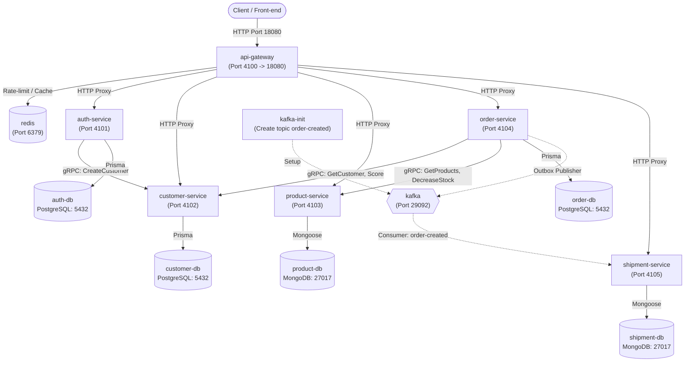

# Ecommerce MVP Microservices

Dự án Ecommerce MVP xây dựng theo kiến trúc Microservices hướng Domain-Driven Design (DDD), Event-Driven Architecture và mô hình Database-per-Service.

---

## 1. Sơ đồ kiến trúc & Container

Toàn bộ hệ thống gồm 14 container hoạt động đồng bộ trên mạng ảo Docker `ecommerce-net`:



---

## 2. Danh sách Containers & Port

| Container | Type | Port Host (Dev) | Port Container | Mục đích / Ghi chú |
|---|---|---|---|---|
| `api-gateway` | Service | **18080** | `4100` | **Entry point duy nhất** (Reverse Proxy, JWT Auth, Rate Limiting, Cache) |
| `auth-service` | Service | – | `4101` | Quản lý định danh, đăng ký, đăng nhập & cấp JWT |
| `customer-service` | Service | – | `4102` (HTTP)<br>`50052` (gRPC) | Quản lý thông tin khách hàng & điểm thành viên |
| `product-service` | Service | – | `4103` (HTTP)<br>`50053` (gRPC) | Quản lý danh mục hàng hóa & trừ kho nguyên tử |
| `order-service` | Service | – | `4104` | Xử lý tạo đơn hàng, tính chiết khấu & Outbox publisher |
| `shipment-service` | Service | – | `4105` | Kafka consumer lắng nghe `order-created`, quản lý trạng thái giao hàng |
| `auth-db` | Database | `15433` | `5432` | PostgreSQL lưu trữ User, Role |
| `customer-db` | Database | `15434` | `5432` | PostgreSQL lưu trữ Customer, Membership |
| `order-db` | Database | `15435` | `5432` | PostgreSQL lưu trữ Order, OrderDetail, OutboxEvent |
| `product-db` | Database | `37018` | `27017` | MongoDB lưu trữ products |
| `shipment-db` | Database | `37019` | `27017` | MongoDB lưu trữ shipments & processed_events |
| `redis` | Cache / Limiter | `16379` | `6379` | Redis cho API Gateway |
| `kafka` | Message Broker | `19092` | `19092` (host)<br>`29092` (nội bộ) | Apache Kafka 3.7 (chế độ KRaft) |
| `kafka-init` | Init Container | – | – | Tự động tạo topic `order-created` khi Kafka sẵn sàng rồi thoát |

> **Quy ước Port khi triển khai toàn diện (Bước 10):**
> - Chỉ duy nhất **`api-gateway`** được publish ra máy host tại port **`18080`** (`http://localhost:18080`).
> - Tất cả các microservice và database giao tiếp với nhau qua mạng nội bộ `ecommerce-net` bằng tên container và port nội bộ.

---

## 3. Hướng dẫn khởi chạy hệ thống bằng Docker

### Bước 1: Chuẩn bị biến môi trường
```bash
cp .env.example .env
```
*(Đảm bảo các biến mật khẩu, port và `JWT_SECRET` đã được thiết lập đúng trong `.env`)*

### Bước 2: Build và khởi chạy toàn bộ 14 containers
```bash
docker compose up -d --build
```

### Bước 3: Kiểm tra trạng thái sức khỏe của các service
```bash
docker compose ps
```
Tất cả các service sẽ đạt trạng thái `Up (healthy)`.

### Bước 4: Kiểm tra Gateway Health Check
```bash
curl http://localhost:18080/api/health
```
Kết quả trả về HTTP 200 kèm trạng thái `UP` của cả 5 microservices phụ thuộc.

### Dừng hệ thống khi cần
```bash
docker compose down
```

---

## 4. Danh sách tài khoản người dùng có sẵn (Seed Data)

Hệ thống đã tự động chạy migration và nạp sẵn 5 tài khoản mẫu:

| Username | Password | Role | Membership Tier | Điểm thưởng | Tỷ lệ chiết khấu |
|---|---|---|---|---|---|
| `admin` | `Admin@123` | `ADMIN` | GOLD | 1000 | 10% |
| `staff` | `Staff@123` | `SHIPMENT_STAFF` | BRONZE | 0 | 0% |
| `bronze_user` | `User@123` | `CUSTOMER` | BRONZE | 0 | 0% |
| `silver_user` | `User@123` | `CUSTOMER` | SILVER | 500 | 5% |
| `gold_user` | `User@123` | `CUSTOMER` | GOLD | 1000 | 10% |

---

## 5. Dữ liệu sản phẩm mẫu & Ghi chú Reset kho

Khi khởi động, **`product-service`** tự động thực hiện script `seed.js` trước khi khởi chạy HTTP/gRPC server để đảm bảo dữ liệu sản phẩm luôn ở trạng thái mẫu chuẩn:

| PID | Tên sản phẩm | Đơn giá ($) | Tồn kho ban đầu |
|---|---|---|---|
| `1` | Laptop | 1500.00 | 10 |
| `2` | Mouse | 25.00 | 100 |
| `3` | Keyboard | 45.00 | 50 |

> **Lưu ý:**
> - Mỗi lần `product-service` khởi động lại (restart container hoặc compose up), tồn kho của 3 sản phẩm trên sẽ tự động được **khôi phục (reset)** về số lượng ban đầu (`10`, `100`, `50`).
> - Sequence counter cho `pid` được đặt về `3`, đảm bảo sản phẩm mới tạo qua API sẽ nhận `pid` kế tiếp là `4`.

---

## 6. Mô hình kiến trúc & Nguyên lý thiết kế

1. **Database-per-Service**:
   - Tuyệt đối không chia sẻ database giữa các microservice. Mỗi service sở hữu trọn vẹn dữ liệu và vòng đời schema của mình.
   - Polyglot Persistence: PostgreSQL cho nghiệp vụ giao dịch quan hệ (Auth, Customer, Order) và MongoDB cho dữ liệu phi cấu trúc/sản phẩm (Product, Shipment).
2. **Giao tiếp đồng bộ qua gRPC**:
   - `order-service` gọi `customer-service` (lấy thông tin, điểm tích lũy) và `product-service` (lấy giá, trừ kho nguyên tử) bằng Protobuf qua gRPC với deadline 3 giây và cơ chế bù trừ (compensating transaction) khi tạo đơn thất bại.
3. **Transactional Outbox Pattern & Event-Driven Kafka**:
   - `order-service` ghi nhận đơn hàng và sự kiện `OrderCreated` trong cùng một database transaction.
   - Outbox Publisher chạy nền định kỳ đọc các sự kiện `PENDING` và đẩy lên Kafka topic `order-created`.
   - `shipment-service` lắng nghe topic với Idempotent Consumer (dựa vào `eventId` và `oid` unique) để tự động tạo `Shipment` ở trạng thái `PENDING`.
4. **Bảo mật & Ủy quyền tập trung**:
   - `api-gateway` xác thực chữ ký JWT, kiểm tra quyền hạn theo vai trò (RBAC) và chuyển tiếp định danh người dùng qua các header bảo mật `x-user-id` và `x-user-role`.
